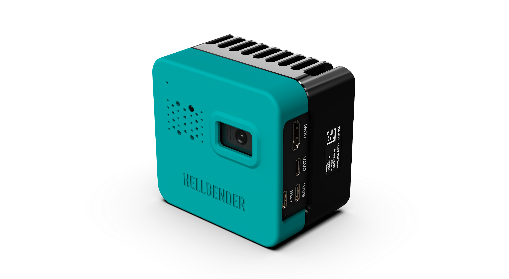

# Hellbender Tendryl Camera

The Hellbender Tendryl Camera was built to make developing and deploying on edge computer vision applications easy. This repository holds examples, firmware updates, and other resources to help accelerate and improve development.

## Firmware Releases & Documentation Index

The table below contains each firmware release and associated user documentation in PDF and HTML form:

| Software Version | Download Link | Release Date | Documentation | Release Notes |
|------------------|---------------|--------------|---------------|---------------|
| v2.0 | [link](https://github.com/HellbenderInc/hellbender-tendryl-camera/releases/tag/v2.0) | 2026-09-01 | [HTML](https://hellbenderinc.github.io/hellbender-product-documentation/tendryl-cam/2.0/) | Initial public release|

## External Software Resources

The Hellbender Tendryl Camera leverages popular hardware and software from Raspberry Pi and Hailo to make development easy. Check out the links below for our partners' development tools and resources:

- The Tendryl Camera comes with `rpicam-apps` installed from this [github repo](https://github.com/raspberrypi/rpicam-apps). Please read the [usage instructions](https://github.com/raspberrypi/rpicam-apps#:~:text=Pi%20documentation%20pages-,here.,-For%20Developers) for details.

- See Hailo's [GitHub repo](https://github.com/hailo-ai/hailo-apps) with links to [user](https://github.com/hailo-ai/hailo-apps/blob/main/doc/user_guide/README.md) and [developer](https://github.com/hailo-ai/hailo-apps/blob/main/doc/developer_guide/README.md) guides for AI-enabled application development

## Hardware Summary

The Hellbender Tendryl Camera uses the Raspberry Pi CM5 Quad Core Cortex-A76 @ 2.4GHz (4GB RAM, 16GB eMMC) for its main compute and the Hailo-8 AI Accelerator as the AI co-processor.

## Support

For questions, visit out our [support forum](https://github.com/HellbenderInc/hellbender-tendryl-camera/discussions) or contact us at [support@hellbender.com](mailto:support@hellbender.xyz?subject=Tendryl%20GitHub%20Page%20Inquiry).
